# The 101s: Google Earth Engine and Planet

A hands-on introduction to two satellite data platforms, Google Earth Engine and Planet, for complete beginners. Presented by the Stanford Geospatial Center.

- **Repo:** https://github.com/mapninja/The_101s_GEE_Planet
- **Slides:** [The 101s: Intro to Spatial Data](https://slides.com/staceymaples/the-101s-intro-to-spatial-data)

## Quick links

| What | Link |
| --- | --- |
| Intro slides | [slides.com/staceymaples/the-101s-intro-to-spatial-data](https://slides.com/staceymaples/the-101s-intro-to-spatial-data) |
| Earth Engine Code Editor | https://code.earthengine.google.com/ |
| Earth Engine notebook | [](https://colab.research.google.com/github/mapninja/The_101s_GEE_Planet/blob/main/notebooks/01_largest_fire_today_workflow.ipynb) |
| Planet notebook | [](https://colab.research.google.com/github/mapninja/The_101s_GEE_Planet/blob/main/notebooks/02_planet_API_101_LakeLagunita.ipynb) |

## Read this first: access

A Stanford email address is required. We cannot add anyone to our platforms without a valid Stanford email.

If you submitted anything other than a Stanford email, apply for access at both sites now if you want to participate:

1. Google Earth Engine: https://code.earthengine.google.com/register
2. Planet Education and Research: https://www.planet.com/industries/education-and-research/

Stanford users can also request Earth Engine help at stanford-geospatial@stanford.edu.

## Contents

1. [Slides](#slides)
2. [Part 1: Google Earth Engine](#part-1-google-earth-engine)
3. [Part 2: Planet](#part-2-planet)
4. [Part 3: Embeddings and AlphaEarth](#part-3-embeddings-and-alphaearth)
5. [More resources](#more-resources)
6. [Repo contents](#repo-contents)
7. [Appendix: Stanford Cleantech Hackathon](#appendix-stanford-cleantech-hackathon)
8. [Appendix: AlphaEarth slides](#appendix-alphaearth-slides)

## Slides

- [The 101s: Intro to Spatial Data](https://slides.com/staceymaples/the-101s-intro-to-spatial-data): introduction to spatial data, the starting point for this workshop.
- Related decks: [Remote Sensing with Earth Engine](https://slides.com/staceymaples/rswithgee) and [Planet at Stanford](https://slides.com/staceymaples/planet-stanford-lovedataweek).

## Part 1: Google Earth Engine

### Meet Earth Engine

Google Earth Engine (GEE) is a cloud-based platform for analyzing satellite imagery and geospatial datasets at scale. It provides:

- An interactive environment for developing and running geospatial analyses.
- A multi-petabyte catalog of satellite imagery and scientific datasets.
- Tools to detect change, map trends, and measure differences on the Earth's surface.

No prior experience with Earth Engine or JavaScript is required. Familiarity with programming, remote sensing, or GIS helps but is not required.

### Set up a Google Cloud Project for Earth Engine

Earth Engine requires a registered Google Cloud Project. Follow these steps once. Stanford users who are attending a workshop should already be in the Stanford GEE Access Workgroup.

#### Create a project

1. Go to https://code.earthengine.google.com/ and log in with your Stanford credentials.

   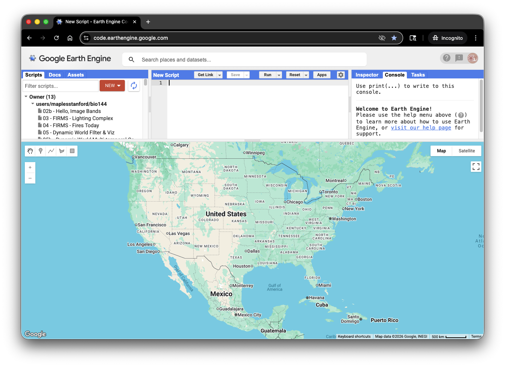
2. Click your profile icon in the top right of the Code Editor and select **Register a new Cloud Project**.

   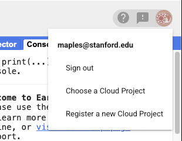
3. Enter a project name.

   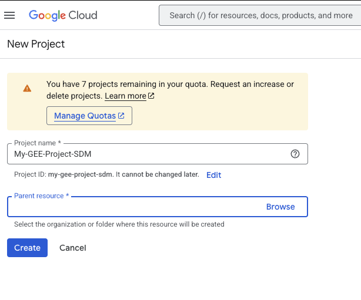
4. Click **Parent resource > Browse** and select **GEE Student Projects**.

   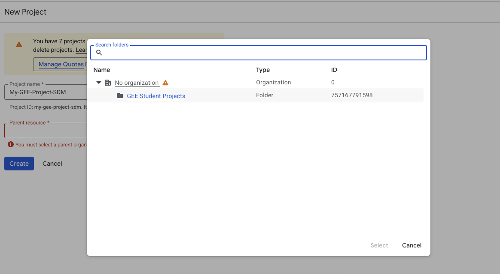
5. Click **Create**.

   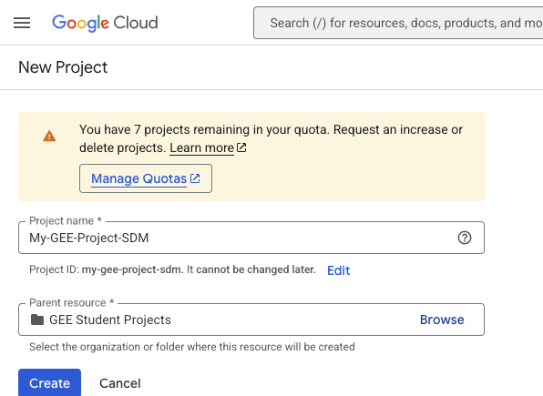
6. If you are not taken to the Configuration Dashboard, click **Select Project** to make the new project active.

   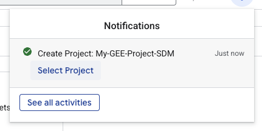

Confirm that the Configuration Dashboard shows the project you just created.

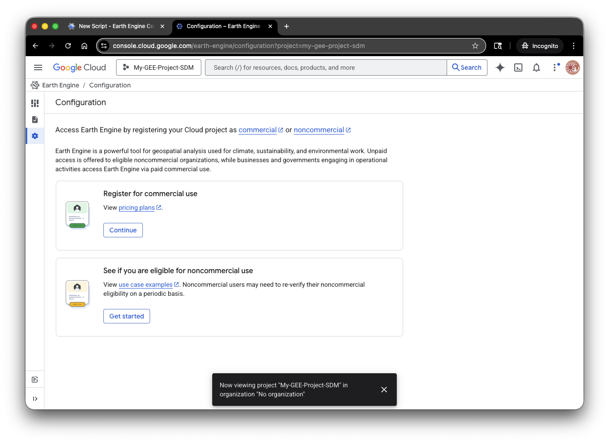

#### Register the project for non-commercial use

Registering as non-commercial gives you access to the Earth Engine API and compute quotas without billing.

1. In the Configuration Dashboard, click **See if you are eligible for non-commercial use**, then **Get Started**.

   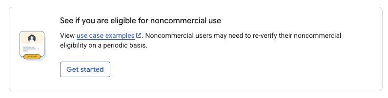
2. Complete the registration form for your use case and click **Check Eligibility**.

   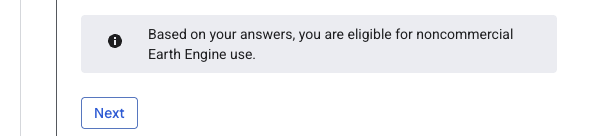
3. Your Stanford project has no billing account, so select **Community**. This tier fits students and small research projects. If you need more capacity, contact UIT for a GCP project with billing enabled (Stanford faculty PI and PTA required).

   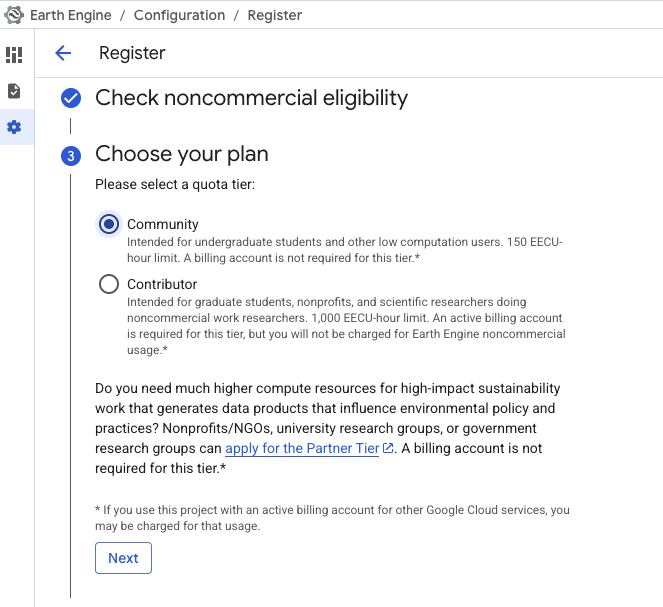
4. Complete the remaining steps and click **Register**.

   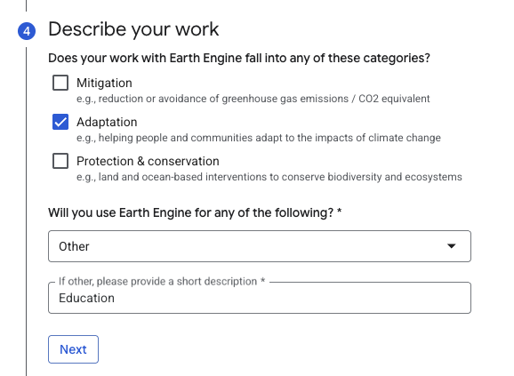

   
5. A pop-up offers to enable the Earth Engine API.

   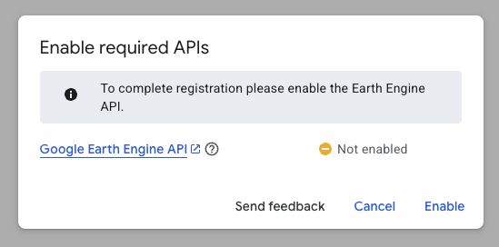

#### Enable the Earth Engine API

1. Click **Enable** in the pop-up.

   

#### Select your project in the Code Editor

1. Return to the Code Editor, click your profile icon, and select **Choose a Cloud Project**.

   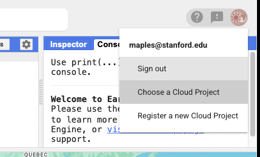

   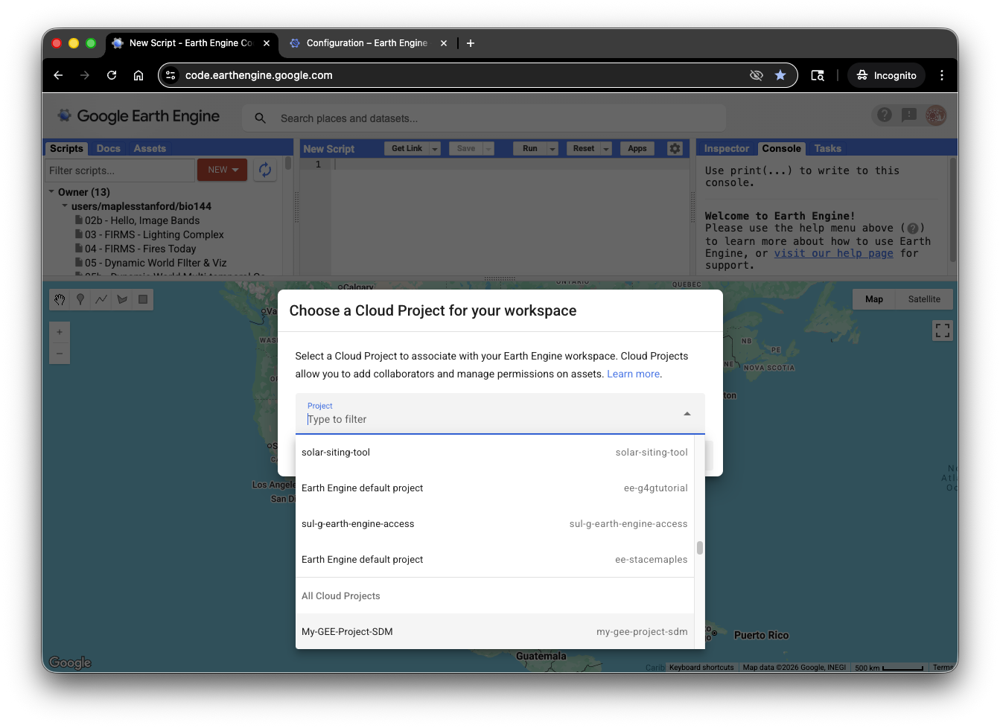
2. Select your project and click **Select**.

   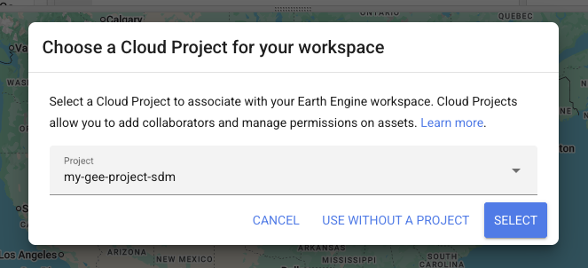
3. Test the setup by running a script. If you do not have one, use this: https://code.earthengine.google.com/f983a2d843739e23ffb77f336ad6d4fb

### Explore sample scripts in the Code Editor

After your Google Cloud Project is set up and selected, explore the commented sample scripts in the Earth Engine Code Editor. If you have an Earth Engine account, open this link to import the scripts:

https://code.earthengine.google.com/?accept_repo=users/stacemaples/SGC-EE101

Use a sample to get familiar with the Code Editor window:

1. In the **Scripts** panel on the left, expand the imported repository and open a sample script.
2. Read the comments and notice how the script is organized in the code editor in the center.
3. Click **Run** above the editor to execute the script with your selected Cloud Project.
4. Look at the **Console** tab on the right for printed results or messages. If the script creates a map, view it in the map panel below the editor; use the **Inspector** tab to explore map features.
5. Try another sample, or change a small part of the code and run it again to see how the result changes.

These samples use the Code Editor's JavaScript API. The Python notebook below is a separate workflow.

To find more data to load in the Code Editor, browse the [Awesome GEE Community Catalog](https://gee-community-catalog.org/). It lists community-contributed datasets that are ready to use in Earth Engine and are not in the official Data Catalog.

### Switch to the Python API

Once you have explored a Code Editor sample, continue with the [Python notebook below](#notebook-largest-active-fire-today). The notebook uses Python and runs in Google Colab or local Jupyter; it is separate from the Code Editor.

**Google Colab**

1. Open the notebook with the Colab link below.
2. Run the first code cell to install libraries.
3. Authenticate Earth Engine in the browser when prompted.
4. Replace `YOUR_PROJECT_ID` in the notebook with the ID of the project you created above.

**Local Jupyter**

1. Create and activate a Python environment.
2. Start JupyterLab or Jupyter Notebook.
3. Run the first code cell to install libraries.
4. Authenticate Earth Engine when prompted.

### Notebook: Largest active fire today

[](https://colab.research.google.com/github/mapninja/The_101s_GEE_Planet/blob/main/notebooks/01_largest_fire_today_workflow.ipynb)

**[⬇ Download lakelagunita.geojson](https://github.com/mapninja/The_101s_GEE_Planet/raw/main/notebooks/lakelagunita.geojson)** (Lake Lagunita area of interest). If the file opens as text in your browser, right-click the link and choose **Save link as**. Then drag it into the Colab Files panel so that it appears at the same level as the foders.

File: [`notebooks/01_largest_fire_today_workflow.ipynb`](notebooks/01_largest_fire_today_workflow.ipynb)

Finds the largest active fire in a chosen area using the NASA FIRMS dataset in Earth Engine. You will:

- Load FIRMS fire detections and choose a day.
- Limit the search with a GeoJSON area of interest (AOI).
- Group fire pixels into clusters and find the largest.
- Export fire boundaries as GeoJSON for use as an AOI in other tools, including Planet.

## Part 2: Planet

### Planet at Stanford

Planet operates a constellation of satellites that image the Earth daily. Stanford affiliates can get education and research access.

- Sign up (stanford.edu email only): https://bit.ly/planetstanford
- Education and research program: https://www.planet.com/industries/education-and-research/
- Stanford Geospatial Center guide to Planet: https://guides.library.stanford.edu/c.php?g=1013467&p=10216495
- Planet University: https://university.planet.com/
- Planet notebooks: https://github.com/planetlabs/notebooks/tree/master/jupyter-notebooks

### Planet tools

- **Explorer:** search, preview, and order imagery in the browser. Includes the Features Manager and code snippets.
- **Basemaps Viewer:** view and symbolize Planet basemaps. Tiles are available programmatically with an API key.
- **Integrations:** [QGIS](https://developers.planet.com/docs/integrations/qgis/), [ArcGIS Pro](https://developers.planet.com/docs/integrations/arcgis/), and [Google Earth Engine](https://developers.planet.com/docs/integrations/gee/) ([quickstart](https://developers.planet.com/docs/integrations/gee/quickstart/)).
- Web maps and tile services: [Klokan's interactive tile demo](https://docs.maptiler.com/google-maps-coordinates-tile-bounds-projection/#2/40.33/14.82) and [Mercantile](https://mercantile.readthedocs.io/en/stable/quickstart.html).

### Get your Planet API key

The notebook needs an API key from your Planet account page: https://www.planet.com/account/

Pick one way to store it:

- **Google Colab Secrets:** store the key as `PL_API_KEY` and turn on notebook access.
- **Environment variable on your computer:** see [Store an API key in Python](docs/API_key_in_python.md) for Mac, Windows, and Conda steps.

Do not commit or share a notebook that shows your key. Clear all outputs first, and reset your key on Planet.com if it is exposed.

### Area of interest

The notebook uses [`notebooks/lakelagunita.geojson`](notebooks/lakelagunita.geojson). Download it, then drag it into the Colab Files panel after you open the notebook.

To make an AOI for your own area, use https://geojson.io/.

### Notebook: Planet API 101, Lake Lagunita

[](https://colab.research.google.com/github/mapninja/The_101s_GEE_Planet/blob/main/notebooks/02_planet_API_101_LakeLagunita.ipynb)

File: [`notebooks/02_planet_API_101_LakeLagunita.ipynb`](notebooks/02_planet_API_101_LakeLagunita.ipynb)

Uses the Planet Data and Orders APIs to study the flooding of Lake Lagunita during the winter 2022-23 atmospheric river events. You will:

- Authenticate with your API key.
- Search PlanetScope imagery by AOI, date, and clear percent.
- Save and map scene footprints.
- Select the fewest scenes that cover the AOI.
- Order clipped composites and plot the results.

Adapted from the [GISDay@Stanford 2023 workshop by Planet developers](https://hello.planet.com/data/s/sdtjXQAPQpmBBbc).

## Part 3: Embeddings and AlphaEarth

Satellite embeddings summarize each location's imagery over a year as a vector of numbers. Locations with similar surfaces get similar vectors, so you can search for look-alikes without labeled training data.

- **Paper:** [AlphaEarth Foundations: An embedding field model for accurate and efficient global mapping from sparse label data](https://arxiv.org/abs/2507.22291) (arXiv:2507.22291).
- **Demo app:** [Embedding similarity search](https://earthengine-ai.projects.earthengine.app/view/embedding-similarity-search#year=2025;zoom=13;lon=73.24504611835016;lat=19.206247673935145;clicked=true;). Click a location on the map to find places with similar embeddings.
- **Related model:** [OlmoEarth v1.3](https://allenai.org/blog/olmoearth-v1-3) from Ai2 is another satellite embedding model. It uses a year of Sentinel-1, Sentinel-2, and Landsat data to produce a 128-dimension vector for each 10 m pixel. Ai2 publishes annual global embeddings for 2023 to 2025, open model weights, and a browser-based Embeddings Explorer for similarity search and small classifiers. Ai2 reports that it outperforms AlphaEarth Foundations on most of its 27 evaluations. See the post for access links and license terms.

## More resources

- [Earth Engine documentation](https://developers.google.com/earth-engine)
- [Earth Engine Data Catalog](https://developers.google.com/earth-engine/datasets)
- [Earth Engine guides (JavaScript, Python, REST)](https://developers.google.com/earth-engine/guides)
- [Earth Engine Developers Group](https://groups.google.com/g/google-earth-engine-developers)
- [geemap](https://geemap.org/)
- [Planet Data API reference](https://developers.planet.com/docs/apis/data/)
- [Planet Python client](https://github.com/planetlabs/planet-client-python)
- Source workshops: [Google-Earth-Engine_101](https://github.com/StanfordGeospatialCenter/Google-Earth-Engine_101), [Planet_API_101](https://github.com/StanfordGeospatialCenter/Planet_API_101), [google_earth_engine_python_101](https://github.com/mapninja/google_earth_engine_python_101)

## Repo contents

```
The_101s_GEE_Planet/
├── README.md
├── docs/
│   └── API_key_in_python.md
└── notebooks/
    ├── 01_largest_fire_today_workflow.ipynb
    ├── 02_planet_API_101_LakeLagunita.ipynb
    └── lakelagunita.geojson
```

## Notes

- Earth Engine notebook: set `project` to your own Google Cloud Project ID before you run it.
- PlanetScope data requires a Planet account with data access. PlanetScope has no SWIR bands, so true NBR needs Sentinel-2 or Landsat.
- Notebooks in this repo are saved with outputs cleared.
- Output files: in Colab, both notebooks mount your Google Drive and save files to a `GEE101` folder (`/content/drive/MyDrive/GEE101`), which they create if needed. Colab asks you to allow Drive access. In local Jupyter, files go to an `output` folder next to the notebook.

## Appendix: Stanford Cleantech Hackathon

This workshop runs as the Google Earth Engine 101 session at the third annual Stanford Cleantech Hackathon, part of Stanford Climate Week.

- **When:** Friday, October 23, 2026, 5:00 to 6:00 p.m. The hackathon runs October 23 to 24.
- **Where:** Mackenzie Room (top floor), Jen-Hsun Huang Engineering Center.

### Event links

- [Hackathon guide (Google Doc)](https://docs.google.com/document/d/15fvWlnVcsQuWeAVbtuQhzrvSHii8ef_fXmh3DPh2FWo/edit?tab=t.0)
- [Hackathon website](https://stanfordcleantechhackathon.com/)
- [Devpost: submit your project by 5 p.m. Saturday](https://stanford-cleantech-hackathon.devpost.com/)
- [Judging criteria](https://docs.google.com/document/d/163qTn8TgOZwRGS02T9tu9vSZ8zTEXGyrqvSrJ0enSc8/edit?tab=t.0)
- [Project challenges and ideas](https://docs.google.com/document/d/1S0Gf53WAzhJuWFr0-btQwcp1esXx82fkO_XfshvrrfM/edit?tab=t.0)

### Data sources for hackathon projects

- **Planet, Stanford affiliates:** [sign-up form](https://forms.gle/oTMeMi4zTqcD4U9n8). Daily, 4 m, multispectral imagery. Non-Stanford EDU users apply at the [Planet education and research page](https://www.planet.com/industries/education-and-research/).
- **Earth Engine Data Catalog:** https://developers.google.com/earth-engine/datasets/
- **Awesome GEE Community Catalog:** https://gee-community-catalog.org/. Community-contributed datasets that are ready to use in Earth Engine.
- **EarthWorks (Stanford Libraries):** https://earthworks.stanford.edu/. Search for geospatial datasets and scanned or georeferenced maps.
- **AirNow API:** air quality data. [AirNow](https://www.airnow.gov/) and [API docs](https://docs.airnowapi.org/).
- **Natural Capital Project Data Hub:** https://data.naturalcapitalproject.stanford.edu/
- **Global Forest Watch:** https://www.globalforestwatch.org/
- **Climate Tech Atlas:** https://climatetechatlas.com/


## Appendix: AlphaEarth slides

- [AlphaEarth slides (Google Slides)](https://docs.google.com/presentation/d/1SOoPxez884xFi6vNH6tienumAsxPlwltdWYdiuRAiw0/edit?slide=id.g364016eefd3_0_5233#slide=id.g364016eefd3_0_5233)

AlphaEarth Foundations is Google DeepMind's satellite embedding model. Earth Engine hosts its annual embeddings as a dataset, so you can use them like any other image collection. For background, the paper, and a demo app, see [Part 3](#part-3-embeddings-and-alphaearth).
